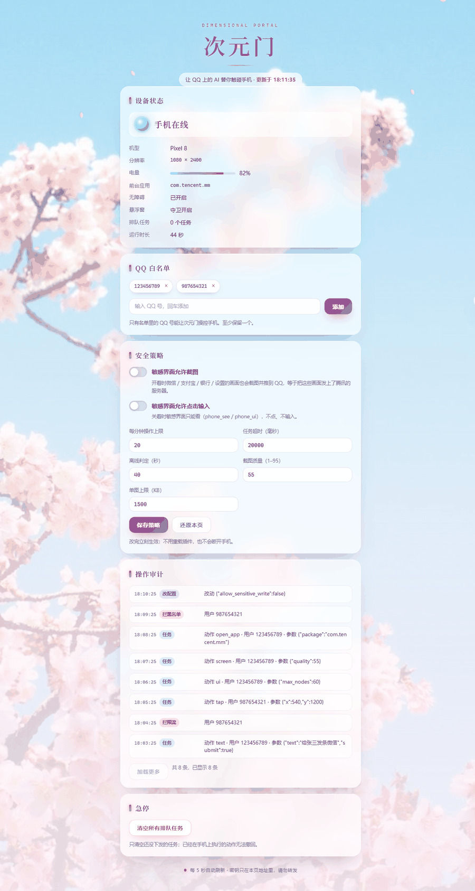

<div align="center">


# 次元门 · Dimensional Portal

**让 QQ 上的 AI 帮你操作自己的安卓手机**

<a href="https://github.com/NishimiyaFukinoto/astrbot_plugin_dimensional_portal/releases/latest"></a>
<a href="https://github.com/NishimiyaFukinoto/astrbot_plugin_dimensional_portal/actions/workflows/tests.yml"></a>
<a href="LICENSE"></a>


`截图` · `点击 / 滑动 / 长按` · `输入文字` · `打开应用` · `按文字找控件` · `远程可用`

</div>

---

在 QQ 里跟「大肥鱼」说一句「看看我手机现在什么界面」，它就会截图发给你；说「打开微信」，手机自己就开了。

**唯一的大脑是 AstrBot 里的模型，手机上不装第二个模型** —— 手机只是「手」，不负责思考。

```
QQ  ←→  腾讯  ←→  NapCat  ←→  AstrBot  ←→  本插件 (aiohttp :8765)  ←→  手机 AutoX.js
                                          ↑
                                   LLM 调 phone_* 工具
```

手机通常在 CGNAT/移动网络后面，不能当服务端，所以永远是 **手机主动长轮询电脑**；
电脑不需要公网 IP、不需要端口映射，配好 Tailscale 后手机用流量也能控制。

## 目录

- [界面展示](#界面展示)
- [功能一览](#功能一览)
- [快速开始](#快速开始)
- [管理控制台](#管理控制台)
- [示例对话](#示例对话)
- [推荐配置](#推荐配置)
- [已知限制](#已知限制)
- [安全须知](#安全须知)
- [常见问题](#常见问题)
- [更多文档](#更多文档)
- [Roadmap](#roadmap)
- [贡献指南](#贡献指南)
- [开发与测试](#开发与测试)
- [依赖](#依赖)
- [免责声明](#免责声明)
- [致谢](#致谢)

## 界面展示

**管理控制台** —— 浏览器打开就能看手机状态、改 QQ 白名单、开关安全策略、翻审计日志、急停（不用 QQ 也能管）：

<p align="center">
  
</p>

> 截图是演示数据（机型 Pixel 8、白名单 123456789 / 987654321）。
> 入口在插件启动日志里，形如 `http://<电脑IP>:8765/console?k=<自动生成的密钥>`；
> 密钥就是配置项 `admin_token`，填 `off` 可整块关闭。
> 配置页里 `admin_token` 的说明下面会直接给出地址 `http://127.0.0.1:8765/console`：在这台电脑的浏览器里打开会自动补上密钥；
> 从别的设备访问要自己在后面加 `?k=<密钥>`（不加会被 403 拦掉，避免泄露）。

## 功能一览

| 场景 | 能力 | 对应工具 |
| --- | --- | --- |
| 看手机 | 截图直接发到 QQ，并附上界面文字摘要 | `phone_see` |
| 看界面 | 读出控件树：文字、坐标、能不能点/能不能输入 | `phone_ui` |
| 看状态 | 在线、电量、分辨率、前台应用、三项权限是否就绪 | `phone_status` |
| 点 | 按坐标点击、长按、滑动 | `phone_tap` `phone_long_press` `phone_swipe` |
| 打字 | 给当前输入框写字，可顺手点「发送/搜索」 | `phone_type` |
| 按键 | 返回、主页、最近任务、音量 | `phone_key` |
| 开应用 | 按包名或应用名启动（微信也能从后台拉起） | `phone_open_app` |
| 找东西 | 按屏幕上的文字找控件并点掉 | `phone_find_tap` |
| 急停 | 清空待执行任务，手机立刻停手 | `phone_stop` |

## 快速开始

### 第 1 步：装插件

**方式 A（最省事）**：打开 [Releases](https://github.com/NishimiyaFukinoto/astrbot_plugin_dimensional_portal/releases/latest)，下载附件 `astrbot_plugin_dimensional_portal.zip`，
在 AstrBot WebUI → 插件 → 安装插件 → **导入压缩包**，选这个 zip 即可（不需要 git、不需要命令行）。

**方式 B**：同样在「安装插件」里直接填仓库地址：

```
https://github.com/NishimiyaFukinoto/astrbot_plugin_dimensional_portal
```

**方式 C**：手动把本仓库的 `plugin/` 整个目录拷到：

```
<AstrBot 实例目录>/core/data/plugins/astrbot_plugin_dimensional_portal/
```

> [!IMPORTANT]
> 装完一定要在 WebUI 里填两个配置，否则插件不干活：
> `token`（手机和插件共用的密钥，随便编一段长字符串）与 `allowed_user_ids`（你自己的 QQ 号）。
> **`token` 留空时插件会拒绝启动 HTTP 服务**——这是故意的，防止裸奔。

### 第 2 步：装手机端

1. 手机上安装 [AutoX.js](https://github.com/autox-community/AutoX)（开源无障碍自动化，不需要 root）。
2. 把 [`phone/dimensional_portal_agent.js`](phone/dimensional_portal_agent.js) 传到手机，用 AutoX.js 打开，改文件顶部的两处：

```js
var BASES = [
    "http://100.x.y.z:8765",     // 电脑的 Tailscale 地址（推荐）
    "http://192.168.1.10:8765"   // 局域网地址（同一 WiFi 时更快）
];
var TOKEN = "和插件配置里一模一样的 token";
```

> 查电脑的 Tailscale 地址：`tailscale ip -4`，通常形如 `100.64.x.x`。

3. 点「运行」，按提示依次允许：

| 权限 | 为什么必须 |
| --- | --- |
| 屏幕录制 | 截图；Android 14/15 记得把「共享范围」选成 **整个屏幕** |
| 无障碍服务 | 点击、读界面、打字全靠它 |
| 悬浮窗（显示在其他应用上层） | Android 10+ 的后台启动限制要靠它豁免，**没它打不开微信这类应用**；脚本会自己挂一个 1×1 几乎透明的窗口 |

4. 建议再把 AutoX.js 加入电池优化白名单，防止被系统杀后台。

### 第 3 步：试一句

在 QQ 里对「大肥鱼」说：

```
看看我手机现在什么界面
```

收到截图就说明整条链路通了。之后可以继续：

```
帮我打开微信  →  点一下搜索框  →  搜「文件传输助手」
```

## 管理控制台

插件自带一个极简网页控制台，手机浏览器也能用（走 Tailscale 地址即可）：

1. 插件启动后在日志里找这一行：

   ```
   [dimensional-portal] 管理控制台：http://192.168.1.10:8765/console?k=xxxxx
   ```

   第一次启动时 `admin_token` 为空，插件会自动生成一个密钥并写回配置，所以这行以后一直有效。
2. 打开后能看：手机在线状态、机型/分辨率/电量/前台应用、队列长度；能改：QQ 白名单（chips 点 × 删除、
   输入框回车添加，至少保留一个号）；能点：**急停**（清空还没下发的任务）。

几个注意点：

- 链接里的 `k` 就是密钥，**别转发**；觉得泄露了就把配置里的 `admin_token` 改掉再重载插件。
- 不想开控制台？把 `admin_token` 填成 `off`，四个控制台路由会彻底不注册（访问返回 404）。
- 控制台只监听插件自己的端口，不会额外开新端口；同一 IP 连续输错 10 次会锁 60 秒。
- V1 只有「设备状态 / 白名单 / 急停」，安全策略开关和审计列表在 V2。

## 示例对话

| 你在 QQ 里说 | 大致发生了什么 |
| --- | --- |
| 看看手机现在什么界面 | `phone_see`：截图 + 界面文字摘要发回 QQ |
| 屏幕上都有什么按钮 | `phone_ui`：列出可点控件和坐标 |
| 帮我打开哔哩哔哩 | `phone_open_app`：后台启动，失败会说明原因 |
| 点一下「设置」 | `phone_find_tap`：按文字找，找不到会列出候选 |
| 往上滑一下 | `phone_swipe`：从屏幕中部上滑 |
| 在搜索框里输入「天气」并搜索 | `phone_find_tap` + `phone_type`（自动点搜索按钮） |
| 按一下返回 | `phone_key` |
| 停 | `phone_stop`：清空队列，手机立刻停手 |

## 推荐配置

| 配置 | 建议 |
| --- | --- |
| `token` | **必填**，手机脚本和插件保持一致，留空插件不启动 |
| `allowed_user_ids` | **必填**，填能遥控手机的 QQ 号；多人测试用逗号分隔。它**不影响聊天**——不在名单里的人照样能和机器人聊天，只是看不到手机工具 |
| `listen_host` | 只在内网用保持 `0.0.0.0`；想更保守就绑 Tailscale 的 IP |
| `screenshot_quality` | 默认 `55`；觉得糊可以调到 70–80，流量吃紧就降 |
| `allow_screenshot_sensitive` | 默认关；微信/支付宝/银行/设置类界面不截图，需要再开 |
| `allow_sensitive_write` | 默认关；敏感界面上点击/输入一律拒绝，只许看。开了才会真的操作 |
| `rate_limit_per_minute` | 默认 20；嫌机器人"手太快"可以降到 10 |
| `debug_token` | **正式使用请留空**；非空会开一个能绕过白名单的调试接口 |

<details>
<summary>完整配置项（14 项）</summary>

| 配置项（面板显示名） | 说明 | 默认值 |
| --- | --- | --- |
| `token`（手机端共享密钥） | 须与 `dimensional_portal_agent.js` 的 `TOKEN` 一致；留空则不启动 HTTP 服务 | 空 |
| `listen_host`（监听地址） | `0.0.0.0` 表示监听全部网卡 | `0.0.0.0` |
| `listen_port`（监听端口） | 被占用时修改此项并重载插件 | `8765` |
| `allowed_user_ids`（QQ号白名单） | 逗号分隔；只决定**谁能遥控手机**，不影响在 AstrBot 里聊天；留空表示不限制，仅建议调试时使用 | 空 |
| `debug_token`（调试密钥） | 非空时启用 `POST /debug/submit`（绕过白名单与限流，仅供本机联调） | 空 |
| `rate_limit_per_minute`（每分钟操作上限） | 单用户 60 秒内允许的任务数 | `20` |
| `task_timeout_ms`（任务超时） | 单位毫秒；截图类任务自动放宽 | `20000` |
| `offline_after_seconds`（离线判定） | 超过该时长未收到心跳即视为离线 | `40` |
| `screenshot_quality`（截图质量） | JPG 质量，1–95 | `55` |
| `max_screenshot_kb`（截图体积上限） | 超过该值的截图会被拒绝发送 | `1500` |
| `allow_screenshot_sensitive`（敏感界面截图） | 是否允许在微信/支付/银行/设置界面截图 | `false` |
| `allow_sensitive_write`（敏感界面写操作） | 是否允许在敏感界面点击/输入；关闭时只能看 | `false` |
| `sensitive_packages`（敏感应用包名） | 逗号分隔；留空使用内置列表 | 空 |
| `package_blacklist`（包名黑名单） | 禁止启动/安装的包名，逗号分隔；留空使用内置列表 | 空 |

</details>

## 已知限制

> [!WARNING]
> 下面是硬限制，不是配置问题：

| 限制 | 说明 |
| --- | --- |
| 锁屏状态 | 无法解锁、无法亮屏操作；息屏时截图会是全黑 |
| 悬浮窗权限 | 没给的话，微信这类应用会「启动请求发出去了但前台没变」 |
| 应用跳转确认框 | vivo/iQOO 可能弹「想要打开 XX」，点一次「始终打开」后不再问 |
| 无障碍屏蔽 | 少数 App（部分银行、游戏反作弊）会主动屏蔽无障碍，读不到界面 |
| 输入法 | 优先 `setText`，失败会退到剪贴板粘贴；个别输入法仍可能失败 |
| 回车键 | 无 root 时无法注入任意按键，`enter` 是靠找「发送/搜索」按钮实现的 |
| 任务不自动重试 | 投递即出队（at-most-once）：手机断线、超时或崩溃后任务直接失败，不会补发；先 `phone_see` 确认真实状态 |
| 敏感界面写入 | 默认全部拒绝（只能看），要操作得手动打开 `allow_sensitive_write` |

M3（相机拍照录像）、M4（下载安装 APK）、M5（前台保活加固）**尚未实现**，见 [Roadmap](#roadmap)。

## 安全须知

- **只在可信网络里跑**。插件默认监听 `0.0.0.0:8765` 且没有内置 TLS；要暴露到公网请套反向代理。
- **`token` 必须改**，且不要提交到仓库。
- **白名单必须非空**。`allowed_user_ids` 为空等于任何能给机器人发消息的人都能操作你的手机。
- **两套白名单别混**：能不能和机器人聊天由 AstrBot 自己的会话/白名单设置决定；`allowed_user_ids` 只决定「能不能遥控手机」，名单外的人聊天不受影响（他们的请求里不会带 `phone_*` 工具）。
- **敏感界面默认不截图**（支付、密码、验证码、银行类）；截图后还会按手机回报的真实前台包名和界面文字再查一次。
- **敏感界面默认不能写**：点击/长按/滑动/打字/按键/开应用在敏感应用上都拒绝；确实需要时在配置里打开 `allow_sensitive_write`，用完关掉。
- **黑名单按真实包名复查**：用中文名「微信」开应用，手机回报真实包名后仍会被拦。
- **调试口默认关闭**，`debug_token` 用完记得清空。
- 所有操作都会写审计日志：`<AstrBot 实例目录>/core/data/plugin_data/astrbot_plugin_dimensional_portal/audit.jsonl`。

## 常见问题

<details>
<summary>说「看看手机」没反应 / 提示手机不在线</summary>

1. 手机上的 AutoX.js 脚本在跑吗？（AutoX 的「运行中脚本」列表刷新较慢，切出去再回来才准）
2. 脚本里的 `TOKEN` 和插件配置里的 `token` 是否一字不差？
3. `BASES` 第一个地址是电脑的 Tailscale/局域网地址吗？先用手机浏览器打开 `http://<电脑IP>:8765/healthz` 试试。
4. 电脑防火墙有没有拦截 8765 端口。
</details>

<details>
<summary>截图是全黑的</summary>

手机息屏了。先让手机亮屏（或把自动锁屏时间调长），再截图。
</details>

<details>
<summary>能打开设置，但打不开微信</summary>

先确认 AutoX.js 有**悬浮窗权限**（Android 设置 → 应用 → AutoX.js → 显示在其他应用上层）。
脚本会自己挂一个 1×1 的透明悬浮窗来拿「后台启动 Activity」的豁免，没有这个权限就会被系统静默拦截。
vivo/iQOO 还可能在第一次弹「应用跳转」确认框，点「始终打开」。
</details>

<details>
<summary>打字没进去</summary>

先「点一下输入框」再输入。脚本会依次尝试 `setText` → 全局 `setText` → 剪贴板粘贴。
</details>

<details>
<summary>端口 8765 被占用</summary>

改插件配置的 `listen_port`，重载插件，同时把手机脚本里的端口一起改掉。
</details>

<details>
<summary>不用 Tailscale，只用同一个 WiFi 行吗</summary>

行。把 `BASES` 里的局域网地址放第一位即可；脚本连不上时会自动在几个地址之间切换。
</details>

## 更多文档

| 文档 | 内容 |
| --- | --- |
| [AGENTS.md](AGENTS.md) | **接手必读**：项目全貌、当前状态、踩过的坑、待办与开工步骤（给新会话 / 新贡献者） |
| [docs/INSTALL.md](docs/INSTALL.md) | 完整安装步骤、权限细节、排错表 |
| [docs/PROTOCOL.md](docs/PROTOCOL.md) | 通信协议：三个端点、动作表、返回结构 |
| [docs/PLAN.md](docs/PLAN.md) | 里程碑、决策记录、已知风险、调试手册 |
| [docs/STATUS.md](docs/STATUS.md) | 进度大纲（已完成 / 待办 P0–P6 / 平台边界） |
| [docs/CONSOLE_PLAN.md](docs/CONSOLE_PLAN.md) | 管理控制台方案与实现记录（V1 / V1.2 / V2） |
| [docs/INCIDENT-2026-11-01-port-conflict.md](docs/INCIDENT-2026-11-01-port-conflict.md) | 事故复盘：NapCat 连不上（Windows 保留端口吃掉 6199） |

## Roadmap

| 方向 | 说明 | 状态 |
| --- | --- | --- |
| M1 基础操作 | 截图、UI 树、点击滑动、输入、开应用 | ✅ 已完成 |
| M2 找文字 | 按文字定位控件并点击 | ✅ 已完成 |
| M3 相机 | 拍照、录像并回传到 QQ | ⏸ 暂停 |
| M4 装应用 | 下载 APK 并调起安装（需手动确认） | ⏸ 待做 |
| M5 保活加固 | 前台服务、断线重连、限流与审计完善 | ⏸ 待做 |
| 管理控制台 | 网页里改白名单、开关安全策略、翻审计日志（见 CONSOLE_PLAN） | ✅ 已完成 |
| 更多平台 | 其他 IM 适配器（未测试） | 💬 待讨论 |

## 贡献指南

欢迎 issue 和 PR。

**提 Issue**

- [Bug 报告](https://github.com/NishimiyaFukinoto/astrbot_plugin_dimensional_portal/issues/new?template=bug_report.md)：附插件版本、AstrBot 版本、手机型号与 Android 版本、复现步骤、脱敏后的日志。
- [功能建议](https://github.com/NishimiyaFukinoto/astrbot_plugin_dimensional_portal/issues/new?template=feature_request.md)：说明使用场景，以及为什么现有工具做不到。

**提 PR**

- 用 [PR 模板](.github/pull_request_template.md)，写清改动范围、验证方式、是否影响协议。
- 改协议（`plugin/bridge/protocol.py` 或动作表）时，请同步更新 `docs/PROTOCOL.md` 与手机脚本。
- 提交前请跑一遍 [开发与测试](#开发与测试) 里的三套测试。

## 开发与测试

```bash
# 不需要真机：假手机客户端跑通 心跳 → 长轮询 → 执行 → 回传（35 项断言）
python tests/smoke_test.py

# 真插件类 + 真 aiohttp + 假手机，直接调工具函数（46 项断言）
# 必须用 AstrBot 实例的 venv python，系统 python 缺 astrbot 依赖
"<实例目录>/venv/Scripts/python.exe" tests/live_server.py

# 在 AstrBot 环境里验证 11 个工具都能注册（docstring → JSON Schema）
python tests/import_check.py

# 手机端脚本必须保持纯 ES5（Rhino 不认 => / let / const / 模板字符串 / includes）
node --check phone/dimensional_portal_agent.js
python tools/check_es5.py
```

`live_server.py` / `import_check.py` 会优先找本机的 AstrBot 实例（可用 `ASTRBOT_INSTANCE` 指定），
找不到就用当前环境安装的 `astrbot` 包；CI 里跑的是后者。

真机回归可以用 `tools/dbg.py` 直接下发动作（需要临时开 `debug_token`）：

```bash
DIMENSIONAL_PORTAL_DEBUG_TOKEN=xxx python tools/dbg.py '{"action":"status"}'
```

## 依赖

```text
aiohttp      # AstrBot 自带；插件只用它 + 标准库
```

手机端额外需要 [AutoX.js](https://github.com/autox-community/AutoX)（Android App，无需 root）。

## 免责声明

本项目仅供个人在自己的设备上做自动化实验。使用前请确认：

- 手机是**你自己的**，或已获得机主明确授权；
- 使用方式符合 QQ/腾讯、AstrBot、AutoX.js 的条款及当地法律法规；
- 不要用于刷量、群控、监控他人等违规用途。

由此产生的一切后果由使用者承担，作者不承担任何责任。

## 致谢

- [AstrBot](https://github.com/AstrBotDevs/AstrBot) —— 插件宿主与 LLM 工具注册
- [NapCat](https://github.com/NapNeko/NapCatQQ) —— QQ 协议端
- [AutoX.js](https://github.com/autox-community/AutoX) —— 手机端无障碍自动化
- [Tailscale](https://tailscale.com/) —— 内网穿透（可选）
- [Unsplash](https://unsplash.com/license) —— 控制台背景照片（Unsplash License，免费商用），
  横版 [「樱花与晴空」](https://unsplash.com/photos/1612875295877-ff60dff48e71)、
  竖版 [「蓝天下的樱树」](https://unsplash.com/photos/1610005908273-cf9e5b615076)

## License

[MIT](LICENSE)
